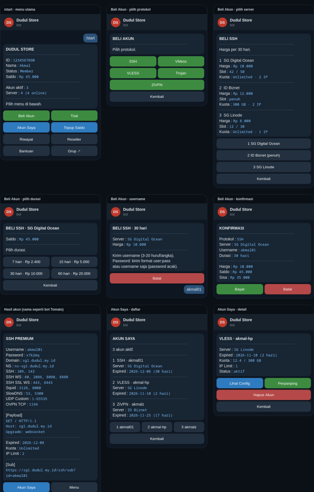
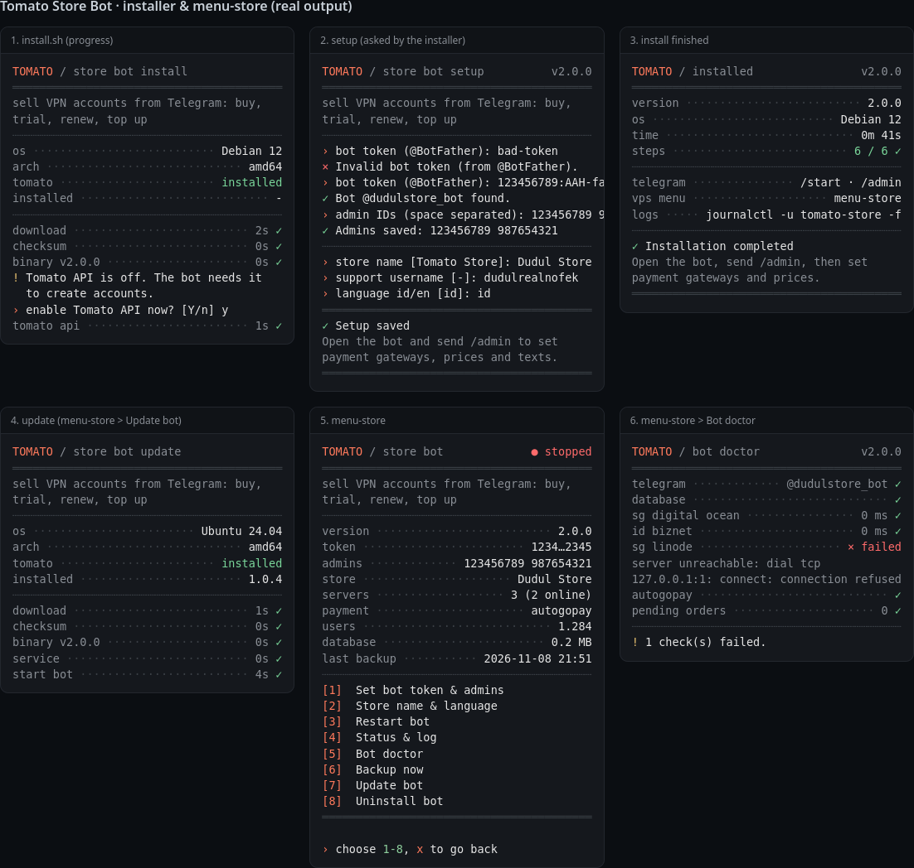
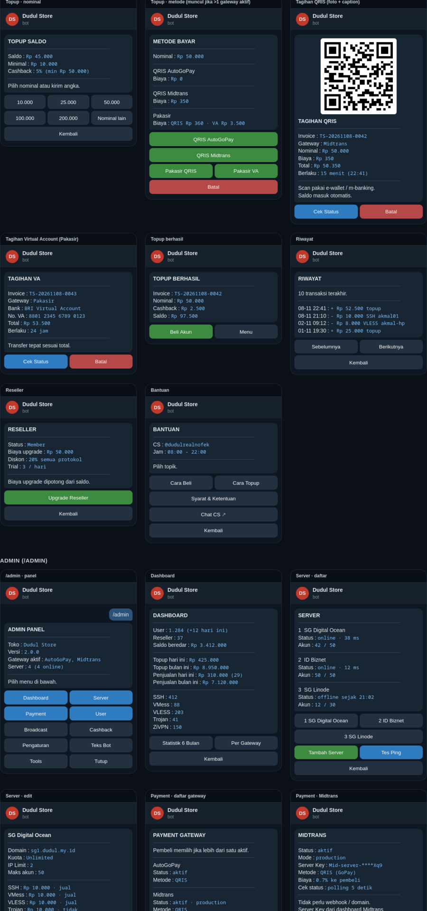

<div align="center">

## `Tomato Store Bot — Telegram VPN Store`

`open source add-on for Tomato Autoscript`

---

**Sell SSH, VMess, VLESS, Trojan and ZiVPN accounts from Telegram. Automatic top up with QRIS and Virtual Account, multi-server, one small binary.**

<a href="https://github.com/dudul19/tomato-store-bot/releases/latest">
  
</a>
<a href="https://store.dudul.my.id/license">
  
</a>


</div>

### Why this bot?
- **One binary, no runtime** — written in Go with an embedded SQLite database. No Node.js, npm, Docker or database server. About 15 MB of RAM.
- **Three payment gateways** — AutoGoPay (QRIS), Midtrans (QRIS) and Pakasir (QRIS + Virtual Accounts). Enable one or all; the buyer picks when more than one is on.
- **No webhook needed** — payments are confirmed by polling, so the bot needs no domain, open port or nginx, and your gateway callback URL stays free for a website.
- **Balance is never lost** — every order is two-phase: the balance is taken, the account is created, and anything the server rejects is refunded automatically. If the connection drops midway, the bot asks the server later and either delivers the account or refunds.
- **Same look as the Tomato bot** — clean cards, colored buttons, no emoji. Indonesian and English.
- **Everything from Telegram** — prices, servers, gateways, texts, cashback, broadcast, backup and restore are all managed from `/admin`.

### Preview
<details open>
<summary><b>Buyer menu</b></summary>
<br>
<div align="center">
  
</div>
</details>

<details open>
<summary><b>Installer & VPS menu</b></summary>
<br>
<div align="center">
  
</div>
</details>

<details>
<summary><b>Top up, payment gateways and admin panel</b></summary>
<br>
<div align="center">
  
</div>
</details>

### Features
| Buyers | Admin | Safety |
|---|---|---|
| Buy accounts: SSH (incl. WS/SSL/SlowDNS/UDP/OpenVPN), VMess, VLESS, Trojan, ZiVPN | Dashboard: users, balance, sales, top ups, 6-month stats, per gateway | Two-phase orders with automatic refund |
| Trial with weekly (member) / daily (reseller) quota | Multi-server: prices per protocol, quota, IP limit, max accounts | Pending orders recovered every 2 minutes |
| My Accounts: view config, renew, delete | Server health check with down / up alerts | Each payment credited exactly once |
| Top up with QRIS or Virtual Account | Payment gateways: keys, test, fee to buyer, Pakasir methods | One action per user at a time, anti spam |
| Reseller upgrade with discount | Users: add / deduct balance, reseller, ban, lock / delete accounts | Late payments (paid as the QR expires) still credited |
| History, expiry reminders with a Renew button | Cashback event, broadcast queue, editable texts | Daily backup to Telegram, restore from `.db` |

### Payment Gateways
| Gateway | Methods | What you need |
|---|---|---|
| [AutoGoPay](https://autogopay.site) | QRIS | API key |
| [Midtrans](https://midtrans.com) | QRIS (GoPay acquirer) | Server Key (sandbox or production) |
| [Pakasir](https://pakasir.com) | QRIS, BRI / BNI / Permata / CIMB / Maybank / Sampoerna / BNC / ATM Bersama / Artha Graha VA | Project slug + API key |

> Set them in `/admin` → **Payment**. The gateway fee can be added to the buyer's bill (Midtrans / AutoGoPay: percentage you set; Pakasir: the fee Pakasir returns).

### Requirements
| | Minimum |
|---|---|
| OS | Linux with systemd (Debian / Ubuntu), amd64 or arm64 |
| RAM | runs inside 128 MB (the bot itself uses about 15 MB) |
| Tomato | at least one server with **Tomato Autoscript** and **Tomato API** enabled |

The bot works best on a Tomato VPS: that VPS is added as a server automatically. It can also run on any other Linux VPS and sell accounts of remote Tomato servers.

### Install
Log in as **root** and run:
```bash
curl -fsSL https://github.com/dudul19/tomato-store-bot/releases/latest/download/install.sh | bash
```
The installer downloads the binary for your CPU, checks its SHA256, enables the Tomato API on this VPS (when Tomato is installed) and asks for:
1. **Bot token** — create a bot with [@BotFather](https://t.me/BotFather).
2. **Admin Telegram ID** — get it from [@userinfobot](https://t.me/userinfobot). Several admins: separate with commas.
3. **Store name** and **support username**.

### After Install
1. Open your bot, send `/start`, then `/admin`.
2. **Payment** → open a gateway → fill in the key → **Test Connection** → **Enable**.
3. **Server** → set the price per 30 days for each protocol, quota, IP limit and max accounts. Other durations are prorated.
4. Add more Tomato servers with **Server → Add Server** (domain + API key from the Tomato menu → System Settings → Tomato API).
5. Try a small top up and a purchase, then check the **Dashboard**.

### Update
`menu-store` → **Update bot**, or:
```bash
curl -fsSL https://github.com/dudul19/tomato-store-bot/releases/latest/download/install.sh | bash -s -- --update
```
Data and config are kept. If the new version fails to start, the installer rolls back.

> Upgrading from tomato-store 1.0.x: the database and config are used as they are; the AutoGoPay key moves into **Payment** automatically.

### VPS Commands
| Command | Function |
|---|---|
| `menu-store` | Setup again, restart, status & log, doctor, backup, update, uninstall |
| `tomato-store doctor` | Check Telegram, database, servers and gateways |
| `tomato-store backup` | Write a backup to `/var/lib/tomato-store/backups/` |
| `journalctl -u tomato-store -f` | Live log |

Files: config in `/etc/tomato-store/`, data and backups in `/var/lib/tomato-store/`.

### Customizing
- **Texts**: `/admin` → **Bot Texts** (welcome, how to buy, how to top up, terms, maintenance), or any text key in `/etc/tomato-store/texts.json`:
  ```json
  { "welcome": "Choose a menu below.\n<i>Open 24 hours</i>" }
  ```
  Keys and both languages are in [`src/texts.go`](src/texts.go). Format: Telegram HTML.
- **QRIS logo**: put `logo.png` in `/etc/tomato-store/` to show it in the middle of the QR code.
- **Log group**: set `"notify_chat": -100xxxxxxxxxx` in `config.json` to send sales and top up alerts to a group instead of each admin.

### Build from Source
```bash
cd src && go test ./...      # end-to-end tests with fake Telegram, Tomato API and gateways
bash build/build.sh          # gofmt + vet + test + amd64/arm64 binaries in dist/
```
Requires Go 1.26 or newer. Dependencies: [`modernc.org/sqlite`](https://modernc.org/sqlite) (pure Go) and [`skip2/go-qrcode`](https://github.com/skip2/go-qrcode).

### Donation
<div align="left">
  <a href="https://saweria.co/dudulrealnofek">
    
  </a>
</div>

#### Credit

 > - [MrDudul](https://t.me/dudulrealnofek)
 > - Telegram Group: [t.me/tfnuklir](https://t.me/tfnuklir)

<div align="center">

  `made with 🤍 from Mr Dudul`

</div>
